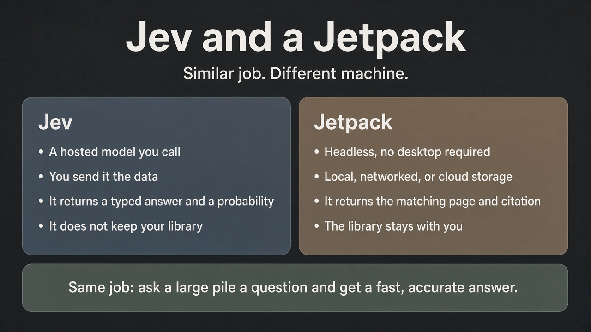

# What a jetpack is

A jetpack is a way to take a large grouping of information, store it, and then do things with that data. It is headless, so it does not need a screen or a desktop app to do its job. The library can live on a local hard drive, a networked drive, or cloud storage. That includes a connected thumb drive: the files live on the stick, and the machine it is plugged into runs the process. A thumb drive will be slower than an internal disk, so indexing and search take longer, but it still works. The same idea can live locally on a mobile device, like an Android or iPhone: the library sits on the phone, and the phone runs the process against that storage. The practical limits are whatever that device allows for space, processing, and running in the background. Those are choices, not requirements. If the library lives in cloud storage and you have an internet connection, local storage is not needed. The other way around works too. You could set up a local jetpack on each person's laptop and phone so they do not need internet to use it. A local copy is also the quickest way to demonstrate it, because it does not depend on a remote connection. The main thing is query: ask a question and get a fast, accurate answer, with the original page cited, instead of reading the whole pile yourself.

Essentially, it is the cheapest way we have found to keep a large body of data that you can still do things with, and to keep context small across time with a team of agents without losing the data or the information.

People sometimes compare this to TypeSafe AI's Jev, or to RAG. The job is similar. The machine is different.

Jev is a hosted model you call as a function. You send it data and a question. It returns a typed answer with a probability. It does not write sentences, and it does not keep your library. TypeSafe describes it as judgments for your code to use, including applying the same question across a large set of records.

A typical RAG retrieves chunks of text and then freely generates an answer.

A jetpack keeps the library with you, wherever you choose to store it. It indexes the files, by words and optionally by meaning. A query returns the matching pages and citations. If nothing fits, it should say so. Writing a normal paragraph from those passages is a separate, optional step, and it should stay faithful to what was retrieved.

We also apply the same idea to sleep. At the end of a long day, instead of keeping the whole conversation loaded, we store a short handoff of what got done, what is still open, and where the files live. The next day starts fresh and reads those notes.

Jev does not store or index your files. A jetpack does. Jev returns a judgment and a confidence. A jetpack returns the source page. Both exist so a person does not have to read a huge pile to get an answer.

TypeSafe's introduction to Jev is at https://typesafe.ai/blog/introducing-system-one-models-and-jev

TypeSafe's note about not calling it a decision model is at https://typesafe.ai/blog/dont-call-it-a-decision-model
